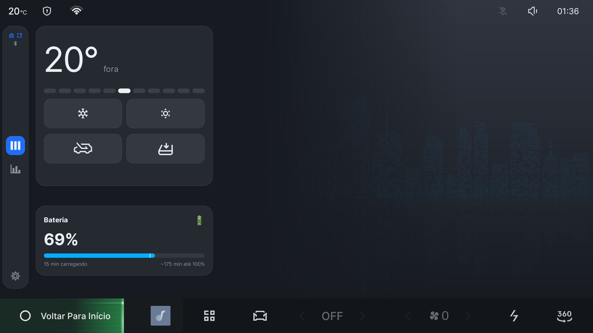

# HVAC Effort Table Architecture

The **Effort Table** (`EffortTable.java`) defines a fixed, 11-column grid representing vehicle HVAC effort from maximum cooling through off to maximum heating:

```
C5  C4  C3  C2  C1   0   W1  W2  W3  W4  W5
```

The scale is **absolute** — it measures the physical effort the vehicle is expending, rather than a relative delta from initial vehicle startup.


*Figure 1: Live Comfort Ruler on the Geely EX2 IHU629G touchscreen. The driver interacts with the absolute effort scale (Warmer / Cooler buttons and center ruler), translating thermal comfort into fan, temperature setpoint, and AC compressor commands with dynamic ambient weather sliding.*

---

## 1. Column Model & Levers

Each column in the table configures five distinct HVAC control levers:

| Lever | Field / Property | Description |
| :--- | :--- | :--- |
| **Power** | `HVAC_POWER_ON` | Binary master power. Level `0` is strictly **OFF**. Levels `C1..C5` and `W1..W5` are **ON**. |
| **Machine (AC)** | `HVAC_AC_ON` | Engages compressor for cooling or heat pump for heating. False in free ambient columns. |
| **Setpoint** | `HVAC_TEMPERATURE_SET` | Target cabin temperature (°C). Active when `machine = true`, `NaN` when off. |
| **Fan Speed** | `HVAC_FAN_SPEED` | Blower intensity across levels 1 to 5: `[1, 2, 3, 6, 8]` cooling (C3 is fan 3 so C2 -> C3 is a small step), `[1, 2, 4, 6, 8]` heating. |
| **Airflow Direction** | `HVAC_FAN_DIRECTION` | Distribution mask: `DIR_FACE` (1), `DIR_FEET` (2), `DIR_FACE_FEET` (3), `DIR_GLASS` (4), or `DIR_GLASS_FEET` (6). |
| **Recirculation** | `HVAC_RECIRC_ON` | Cabin air recirculation. Used as an intensity lever on cooling; restricted on heating. |

### Pinned Extremes vs. Sliding Middle
* **Pinned Extremes (`C5`, `W5`, `0`)**:
  * **`0`**: HVAC powered completely off.
  * **`C5`**: All-out cooling — maximum fan (8), lowest setpoint (17 °C), recirculation active, air to face.
  * **`W5`**: All-out heating — maximum fan (8), highest setpoint (32 °C), fresh air, air to face + feet.
* **Sliding Middle (`C1..C4`, `W1..W4`)**: The boundary between free outside air and compressor/heater engagement shifts dynamically with ambient outside temperature (`outC`).

---

## 2. Weather Sliding & Free Columns

When outside air can comfortably assist, lower effort columns use fresh air without running the compressor (`machine = false`):

```
freeColumns(outC, coldSide)
```

### Cold Side (`C1..C5`)
* **Reference**: `FRESH_LIMIT_C = 28.0 °C`. Moving outside air is comfortable on skin up to 28 °C.
* **Expansion**: Below 28 °C, free ambient columns expand at **1 column per 4 °C drop**:
  $$\text{Free Columns} = \min\left(3, \left\lfloor\frac{28.0 - \text{outC}}{4.0}\right\rfloor + 1\right)$$
  * Above 28 °C: 0 free columns (all levels `C1..C5` use the compressor).
  * 25 °C – 28 °C: 1 free column (`C1` ambient, `C2..C5` compressor).
  * 21 °C – 24 °C: 2 free columns (`C1..C2` ambient, `C3..C5` compressor).
  * Below 21 °C: 3 free columns (`C1..C3` ambient, `C4..C5` compressor).

### Warm Side (`W1..W5`)
* **Reference**: `CABIN_TARGET_C = 23.0 °C`. Outside air can only heat if ambient temperature exceeds cabin target.
* **Expansion**: Above 23 °C, free ambient columns expand at **1 column per 2 °C rise**:
  $$\text{Free Columns} = \min\left(3, \left\lfloor\frac{\text{outC} - 23.0}{2.0}\right\rfloor + 1\right)$$

---

## 3. Airflow Direction & Recirculation Strategy

The airflow path and recirculation state are engineered to maximize passenger comfort and prevent glass fogging:

### Airflow Direction
* **Cold Side**:
  * **Free Ambient (`machine = false`)**: Directed to **Face** (`DIR_FACE`). Moving fresh air across skin provides direct cooling sensation.
  * **First Compressor Step (`level == free + 1`)**: Directed to **Glass / Defrost** (`DIR_GLASS`). The compressor's initial cold output is deflected away from passenger faces while gently chilling cabin air.
  * **Higher Compressor Steps (`level > free + 1`)**: Directed to **Face** (`DIR_FACE`) for direct cooling.
* **Warm Side**:
  * **Thermal Comfort & Defogging Physics (`W2..W4` when $\text{outC} < 23^\circ\text{C}$)**: Directed to **Glass + Feet** (`DIR_GLASS_FEET`, `6`). Warm air flows to footwell vents for lower-body comfort while washing the windshield with a warm air boundary layer to prevent glass fogging from occupant respiration.
  * **Mild Windshield Warming (`W1` when $\text{outC} < 23^\circ\text{C}$)**: Directed to **Glass** (`DIR_GLASS`), using outside air — see Recirculation Logic below.
  * **Warm Days ($\text{outC} \ge 23^\circ\text{C}$)**: Directed to **Feet** (`DIR_FEET`) since ambient air is warm and glass fogging does not occur.
  * **All-Out Heating (`W5`)**: Directed to **Face + Feet** (`DIR_FACE_FEET`) for immediate full-body warmth.

### Recirculation Logic
* **Cooling**: Recirculation is an intensity lever. When ambient outside air is hot ($\text{outC} > 23^\circ\text{C}$) and the compressor is operating past the first step (`level > free + 1`), recirculation engages because cooling already-conditioned cabin air is substantially more effective than cooling hot outside air.
* **Heating**: Recirculation is disabled across every heating level, with no exception. `W1` used to be an exception, on the reasoning that its gentle output made recirculated air "safe" — backwards in practice: `W1` is the column aimed directly at the windshield (`DIR_GLASS`), which is exactly where recirculated cabin air's occupant-respiration humidity is most likely to condense into fog on contact with cold glass. Outside air, even cold, is what actually clears a windshield — the same reason every real car's defrost mode forces outside air.

---

## 4. State Fitting Algorithm (`fit`)

When physical OEM controls or third-party apps alter HVAC settings, `EffortTable.fit()` maps the vehicle state back to the nearest column:

$$\text{Effort} = \text{AllOut} - \max_{\text{levers}}(\text{steps to reach all-out value})$$

* **Worst-Case Distance**: Distance is measured as the maximum number of discrete button presses a lever must advance to reach all-out, not the sum across levers.
* **Fan**: Measured by magnitude — the highest column whose flow requirement is met or exceeded.
* **Compressor Gating**: Machine state strictly gates valid columns: a compressor-off vehicle cannot map to a compressor-on column, and vice versa.
* **Approximate State ("C4ish")**: If physical levers are split across recipes (e.g., fan at `C5`, but direction at `C3`), the ruler marks the state as `approx = true`.
  * The current effort number remains displayed.
  * The first user tap on **Cool** or **Warm** instantly snaps all physical levers to an exact column recipe.

---

## 5. Automatic Re-sliding Guards

As ambient outside temperature changes, `ComfortRuler` re-slides the table to update recipes while keeping the driver's selected effort level (`level`) steady.

To avoid erratic changes, an automatic re-slide only occurs when **all** of the following conditions are met:

1. **Drift Magnitude**: Outside temperature drifts by $\ge 2.0^\circ\text{C}$ (`DRIFT_C`) from the table's build temperature.
2. **Sustained Duration**: The temperature shift persists continuously for $\ge 10\text{ minutes}$ (`DRIFT_MS`) to ignore tunnels, stoplights, or brief thermal pockets.
3. **Quiet Period**: No UI taps have occurred within the last 60 seconds (`QUIET_AFTER_TAP_MS`).
4. **Exact Column Match**: The vehicle must not be in an approximate state (`approx == false`). If a driver adjusted a lever manually, automatic re-sliding is suspended so it never overrides manual intent.

> [!NOTE]
> **User Taps Bypass Timers**: When the driver taps **Cool** or **Warm**, the ruler immediately checks if ambient temperature has drifted by $\ge 2.0^\circ\text{C}$ and rebuilds the table instantly, ensuring immediate user actions always reflect current weather.

## 6. The Table File (`ComfortTable`)

The ruler reads its columns from one file, `files/comfort-table.json`. The rules above only make its **defaults**.

* **One set of columns per weather band.** Each side has 4 bands, by its free-column count: cold `28 C and up`, `24-28 C`, `20-24 C`, `below 20 C`; warm `below 23 C`, `23-25 C`, `25-27 C`, `27 C and up`. Inside a band nothing changes with the outside temperature. The rules made each setpoint from the exact temperature, and it moved inside a band, sometimes the wrong way (C4 was 18, 19, 18, 19, 20, 19 °C from 20 to 25 °C outside).
* **Defaults**: the rules at one temperature inside each band (`ComfortLearn.bandOutC`).
* **Who writes it**: the app writes the defaults on the first start, and the weekly learning changes one column in place. It can be edited by hand; the ruler does not care who wrote a value. A hand edit counts from the next tap or band change.
* **A file the ruler cannot use is written again**: missing, not JSON, a missing value, fan outside 1..8, setpoint outside 17..32 °C or on the wrong side of 24.5 °C, AC on a fan-only column (or off on an AC column), or a column that does not read back as itself. The new file is the defaults plus every learned value that still fits.
* **Software update**: `ComfortTable.VERSION`. Bump it when the defaults change; a file of another version is written again the same way.
* **Re-slide**: a weather change re-applies the level only when it crosses into another band; inside a band the columns are the same.
* **In the app backup**, next to the certificates.

```json
{
  "version": 1,
  "cold": [
    { "outside": "24-28 C", "fan_only_columns": 1,
      "C1": { "ac": false, "fan": 1, "dir": "face", "rec": false },
      "C2": { "ac": true, "sp": 24, "fan": 2, "dir": "glass", "rec": false },
      "...": "C3..C5" },
    "... 3 more bands"
  ],
  "warm": [ "... 4 bands, W1..W5" ]
}
```

## 7. Learn Mode (`ComfortLearn`)

On by default. Switch: **Config → Climate → Learn from my changes**. With it off the ruler keeps its table and stops learning. **Reset ruler to default** writes the default table and forgets what was learned.

* **The signal (a "hold")**: a change made by hand on the car's own climate panel, after the ruler set a column exactly, held for 10 minutes with no tap and no suspend in between. The ruler checks every beat (30 s, 10 s with the screen open); a gap over 2 minutes is a suspend and starts the hold again. One hold counts once, however long it lasts.
* **The column it counts for**: on the fitted side, the column with the fewest different levers (ties go to the column the ruler last set). A different machine (AC) state, or more than 2 different levers, is not a tweak: it is logged as `skip` and not counted. The pinned columns (`0`, `C5`, `W5`) are never counted.
* **Weekly decision**: the ruler changes once a week, and only while the climate is off, so it never changes during a drive. Per column and lever, the value held most often that week wins, if it was held at least 2 times and more often than any other value. Then the week's holds are cleared. The value goes into the table file's column in place, so a hand edit of another lever in that column stays. Learning the default value again removes it from the record.
* **Per weather band**: the key is the level plus the free-column count of that side (`3@1` = `C3` at 24–28 °C outside), so a change at 26 °C does not touch `C3` at 30 °C.
* **Order is kept**: a learned value is used only if the column's fan and setpoint stay between its neighbours, it still fits back to its own level, and no other column stops doing so. Otherwise it is refused.
* **Levers learned**: fan, setpoint, air direction, recirculation.
* **Log**: every hold, skip and weekly result is a `comfort_event` row with `event = 'learn'` (detail like `hold C3@1 fan=4 x2`, `skip C3@1 fan=5 sp=22.0 dir=4`, `learn C3@1 fan=4 x2`, `undecided ...`, `refuse ...`).
* **Storage**: the table is the file (section 6). One text pref, `comfort_learn_book`, holds this week's holds and the record of every learned value, used to try them again when a new table is written. Both are in the app backup. The settings page lists what was learned, the last change date, and this week's count.
