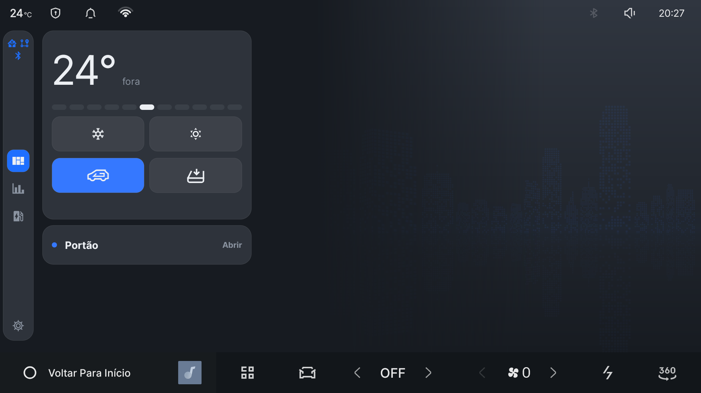
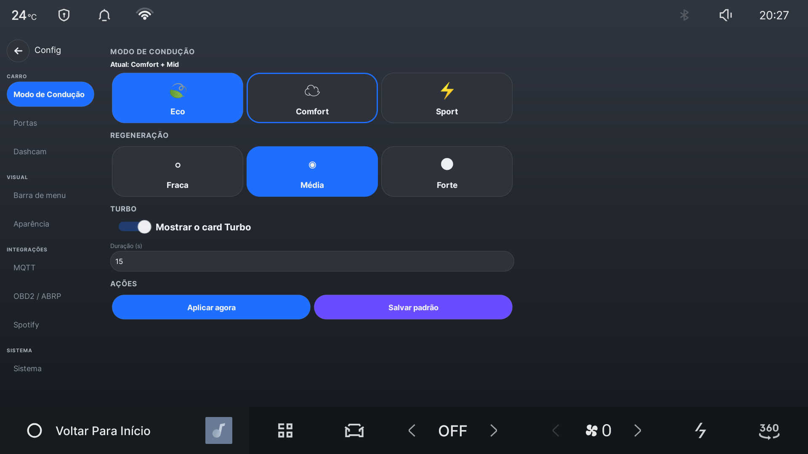
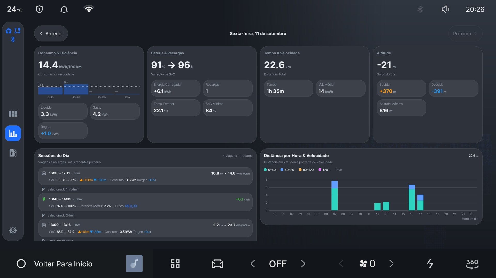
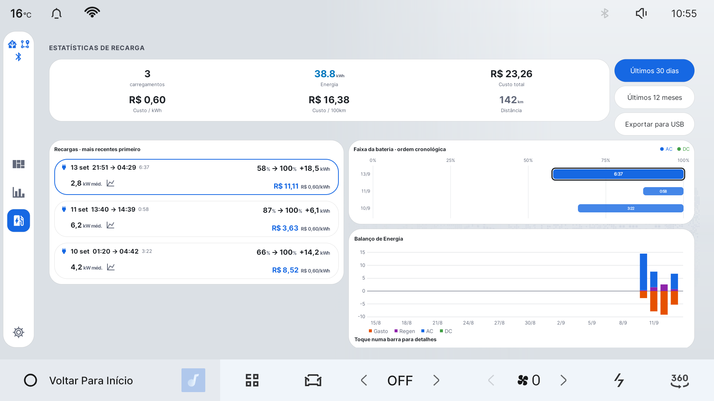

# Drive Assist: a guide for drivers

**English** · [Português (Brasil)](DRIVER-GUIDE.pt-BR.md)

Drive Assist adds the dashboard Geely owners wish the car had shipped with. It
runs on the EX2 / Geometry E centre screen and brings climate shortcuts, a real
driving and charging history, trip maps, useful status, and optional connections
to services you already use — all in one place.

This guide is about using the app. Protocols, vehicle property IDs, and the
reverse-engineering evidence are in the
[technical library](README.md#technical-library).

## Your everyday dashboard

The home screen is made for quick use while you drive:

- The big number is the outside temperature.
- The comfort scale asks for cooler or warmer air in one move, instead of
  setting fan, temperature and A/C one by one.
- Large buttons do cooling, heating, recirculation and a window clear.
- While the car charges, a charging card takes the place of the Parked card. It
  shows the time charging, the time left to 100%, the battery level, the energy
  added and the charging power. Tap the card, during or after the charge, to
  open the charge's page: power, temperatures and battery % on one time line
  (move a finger on the charts to read every value), the numbers, the place on
  a map, AC or DC, and the time at 100%. Tap the cost (it has a pencil) to add
  the price.
  After the charge, the card stays until you add the price (zero too). Then it
  closes. **✕** closes it at once, and it also closes when the car leaves Park.
  You can still add the price in Charging stats.
- Optional cards can show your garage gate, a panel sent by Home Assistant, or
  what your phone plays through the car.

The buttons are large, and most of the screen stays calm, so the useful part is
easy to read at arm's length.

## The car remembers your settings

Drive Assist remembers the drive mode and regeneration level the car is set to
— whether you changed them in the car's own screen, in Drive Assist, or with
the Regen cycle button — and puts them back in Park when the car starts, so
they survive a shutdown and power-up cycle. Temporary boosts (Turbo and the
Strong-regen toggle) stay temporary. AVAS mute and AEB are controlled
explicitly from Drive Assist (turning AEB off in the car's own screen stays
temporary; turning it off in Drive Assist keeps it off across restarts).

Settings are grouped in **Config**: Doors, Climate, Driving mode, Elements (what
shows on the home screen), Appearance (themes and Auto day/night), and System.

Vehicle settings are applied through the small **ModeHelper** companion that
installs with Drive Assist. The dashboard and the privileged helper stay
separate, for safety and reliability.

## Understand each day, not just the odometer

**Driving stats** turns the car's raw readings into a diary:

- distance, driving time, the speed while moving, and the number of trips;
- the battery in percent: how much you used, the lowest and highest level,
  what the charges put in, and the outside temperature (the battery's own
  too, with an OBD2 dongle);
- **Energy by use**: where a trip's energy went — drive, climate, and other —
  and how much regeneration brought back (measured by CAN);
- efficiency by speed range, in Wh/km;
- climbing, descending and the day's height balance;
- a timeline of drives and charges, with parked time between them;
- a **year of days**: every day coloured by how far you drove, with a week,
  month and year view.

Tap a finished trip (in Park) to see its **route** on an OpenStreetMap map,
coloured by speed. The map needs the internet the first time a place is shown;
after that it is kept in the car, so a trip that ends in a garage still shows its
map. Under the route is the height along the trip, and the trip's numbers.

Tap the trip count to open **all routes in one picture**. Routes are recorded
from **Config → System** (on by default) and stay in the car. You can export
them as **GPX** (one file per day) and the trip list as **CSV**, to a USB stick
or to your phone.

If the car was lent out in **Valet** mode, tap its card for a detail screen: a
map of every move, a timeline, the dashcam clips from that time, and the numbers
(moves, time moving and parked, distance, top speed and power, battery and
temperature low to high).

## Charging and cost

**Charging stats** keeps every past charge — energy, time, battery change and
average power. Tap a charge (in Park) to add or fix its price; a free charge can
be saved as zero, and that stays different from a charge whose price you never
entered. To change the currency symbol (R$ by default), go to Config → Elements
→ Localization. There is a month and year view, a battery-temperature card, and a map
of the places where you charge.

A **battery health** card shows kWh per charge, the hours the battery spent below
10% and 20%, and — with an OBD2 dongle — the battery's state of health. Without a
dongle, the charge screen still shows the outside temperature during the charge.

## Bring your own services

These are optional. Drive Assist works as an in-car dashboard without any of
them. Set them up in **Config → Integrations**, which shows each one's status
(connected, needs setup, or failing).

### Home Assistant

Connect your own Home Assistant server to see battery, range, location, charging,
climate and more at home. Home Assistant can also send a panel to the car — a
ferry wait, a doorbell image — and make a garage-gate button appear when the car
reaches home. Vehicle data goes only to the server you set. See the
[Home Assistant guide](HOME-ASSISTANT.md).

### A Better Routeplanner

Drive Assist can send live battery and position to ABRP, so long-trip planning
matches what the car is doing now. An optional Bluetooth OBD2 dongle gives finer
battery data. See the [ABRP guide](ABRP.md).

### Music

Turn on **Config → Integrations → Music → Phone music** and the home screen
shows what your phone plays through the car (Bluetooth, Apple CarPlay or
Android Auto), from any app, with Play and Skip. There is no sign-in. Drive
Assist reads this from the car's own music apps; no permission is asked, and
nothing leaves the car. The small equalizer (three sliders) in the card's top-right corner opens the
car's own sound settings, with the equalizer. **Large card** on the same page
gives the card full album art and big Play and Skip buttons.

Turn on **Lyrics search** on the same page to see the words of the song. The
**Lyrics** button on the card grows it to two columns and the full height of
the screen. At the top are the art, the song, the artist and the album. Under them are the words of the song,
in time with it: the line sung now in large type, the line before it, and the
next two. The bar at the bottom has Play, Skip and **✕**, which closes the
lyrics. The card remembers your last choice, open or closed, from song to song
and after the car sleeps. The card stays at its normal size when the Home
Assistant panel is up, or when the other cards need more than one column.

The lyrics come from [LRCLIB](https://lrclib.net), a free lyrics site. To find
them, the car sends the song, artist and album names there, once for each song.
The car keeps the lyrics of the last 1000 songs and the covers of the last 200 albums,
so a song heard again needs no internet.
A wrong cover? Press and hold it. The car forgets that album's cover and takes
the cover from the phone again.
Some songs have only untimed lyrics on LRCLIB. The card shows them too, but they
do not move by themselves, and a small struck-through clock shows at the top:
tap the lower half of the lyrics to go down one line, the upper half to go back one. For a song with no lyrics at all, the Lyrics
button is dim, and tapping it says "No lyrics found for this song".
Timed lyrics a little early or late? Tap the lock at the top. The card then
shows every line. Tap each line when it is sung: the other lines move with your
taps, and the car keeps the fix for that song. One tap moves all lines by the
same amount; more taps also fix lyrics that drift. The turning arrow undoes the
fix, and so does holding the cover. The lock closes by itself on the next song. Do this when parked.
With the switch off, the car sends nothing there.

### Dashcam

The optional dashcam uses the car's own cameras and can burn in time, position
and speed. Clips copy to a USB stick, or download to your phone. Read the
[dashcam guide](DASHCAM.md) first: storage and local recording rules vary by
region.

The dashcam works only on cars with the 360 cameras. Drive Assist asks the car.
If the car does not report them, the dashcam stays off and the Dashcam page
shows what the car reported. **Settings → System → Car equipment** shows the
same values on every car.

## More you can do

- **Phone access**: scan a QR code on the car screen to get a page on your phone
  for backups, clips and trip files. It runs only in Park, on the local network.
- **Backup and restore**: save your settings, trips and certificates to a USB
  stick and to the car, locked with a password you choose.
- **Darkest mode**: at night, after a minute of driving with no touch, the
  screen goes to its lowest light and a dark layer covers the Dashboard. A
  touch or a gear change brings it back. It runs only in its own hours
  (21:00 to 06:00 by default; drag the handles on the 24-hour line).
  Darkness makes it even darker: 0 % is the lowest light only, 100 %
  turns the screen off (70 % by default). Turn on **On every screen** to
  darken every app, not only the Dashboard. Its Try button shows it at once.
- **Car app translations** (Config → Integrations): better text for the car's
  own Energy, Wi-Fi, Settings and Permissions apps. The car's files are not changed; Remove
  or Cleanup takes it away. Install and Remove wait for Park.
- **Lock sound**: change the sound the car plays when it locks, or import your
  own.
- **Cleanup**: a screen that removes Drive Assist, its helper and the CAN reader,
  and gives the car's own lock sound back — useful before a workshop visit.

## What Drive Assist can control

Drive Assist mostly touches comfort and convenience: climate, drive mode,
regeneration, cabin lights, windows, charging, and the optional Home Assistant
gate.

It does not steer, brake, accelerate, unlock doors, or release the boot. Door and
body signals it shows are read-only.

Two switches affect safety systems, and both are your choice: one can turn off
AEB (automatic emergency braking), and one can mute AVAS (the pedestrian warning
sound). The [safety and privacy guide](WELCOME.md) lists everything the app can
read, change and send. On a car that reports no AEB, the AEB switch is not
shown.

## Getting it onto the car

The easiest way for most owners is the single USB installer — see the
[short installation guide](QUICK-INSTALL.md). The car must already be unlocked
for third-party app installation.

Owners who already use ADB have computer-assisted methods too. Start with the
choice guide in [Installation](INSTALL-GUIDE.md).

## Where to go next

- [Install Drive Assist](QUICK-INSTALL.md)
- [Understand root ADB access](ADB-ROOT-SAFETY.md)
- [Connect Home Assistant](HOME-ASSISTANT.md)
- [Connect ABRP](ABRP.md)
- [Read the safety and privacy explanation](WELCOME.md)
- [Browse the technical discoveries](README.md#technical-library)
