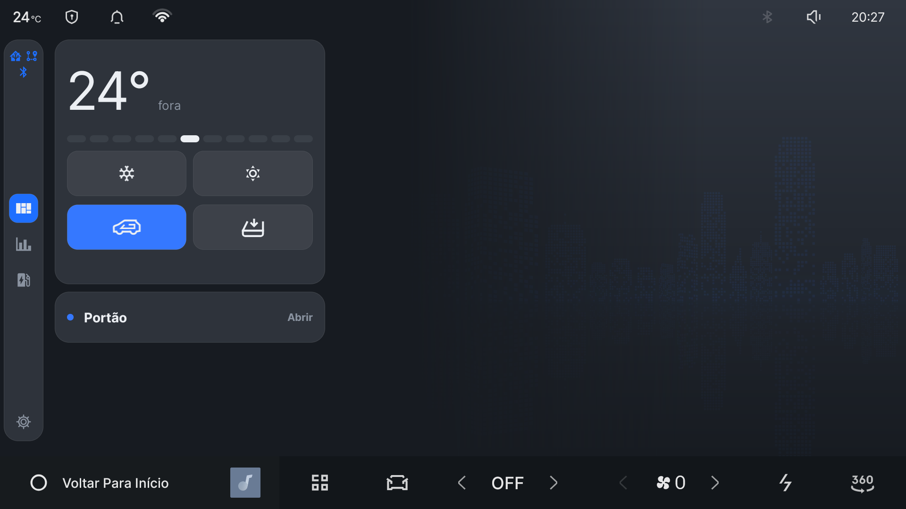
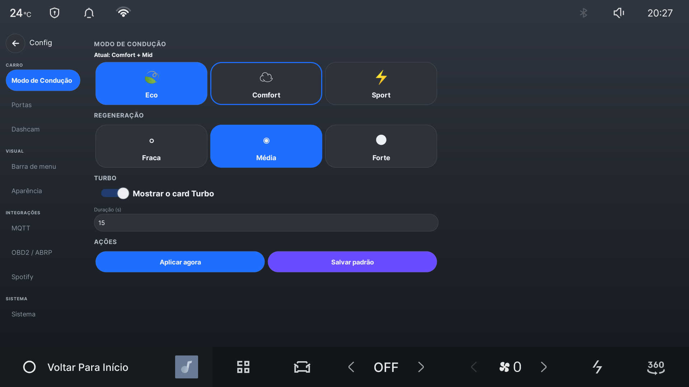
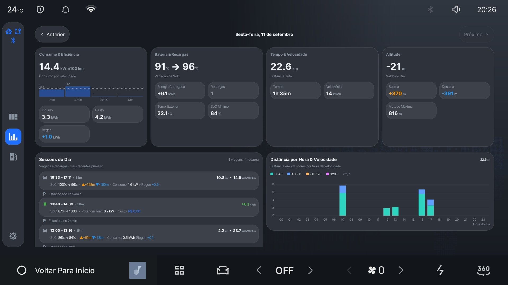
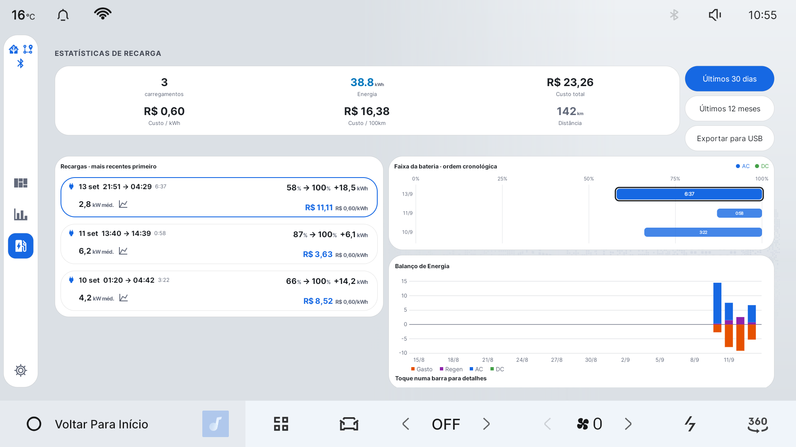

# Drive Assist: guia para motoristas

[English](DRIVER-GUIDE.md) · **Português (Brasil)**

O Drive Assist acrescenta à central do Geely EX2 / Geometry E o painel que
faltava: atalhos de climatização, um histórico de verdade de viagens e recargas,
mapas de viagem, informações úteis e conexões opcionais com serviços que você já
usa — tudo em um lugar.

Este guia é sobre usar o app. Protocolos, identificadores do veículo e as
evidências da pesquisa estão na
[biblioteca técnica](README.md#technical-library).

## Seu painel para o dia a dia

A tela inicial foi feita para uso rápido enquanto você dirige:

- o número grande é a temperatura externa;
- a escala de conforto pede ar mais frio ou mais quente em um toque, em vez de
  ajustar ventilador, temperatura e A/C um a um;
- botões grandes fazem resfriar, aquecer, recirculação e abrir um vão nos vidros;
- durante a recarga, um cartão de recarga fica no lugar do cartão Estacionado.
  Ele mostra o tempo carregando, o tempo até 100%, o nível da bateria, a energia
  colocada e a potência. Depois da recarga, toque no cartão para ver a curva de
  potência, ou toque no quadro de custo para informar o preço;
- cartões opcionais mostram o portão da garagem, um painel enviado pelo Home
  Assistant, ou o que o celular toca pelo carro.

Os botões são grandes e a maior parte da tela fica calma, para a informação útil
ser lida de longe.

## O carro lembra das suas preferências

Escolha o modo de condução e o nível de regeneração que você prefere. O Drive
Assist os reaplica quando o carro acorda ou é ligado, para você não repetir o
ajuste a cada viagem. Modo de condução e regeneração são reaplicados só em P. Cada ajuste tem uma chave **Restaurar ao ligar** (ligada por padrão);
desligue para um ajuste que você prefere mudar na tela do próprio carro.

Os ajustes ficam em **Config**: Portas, Climatização, Modo de condução, Elementos
(o que aparece na tela inicial), Aparência (temas e dia/noite automático) e
Sistema.

Os ajustes do veículo são aplicados pelo pequeno auxiliar **ModeHelper**,
instalado junto com o Drive Assist. O painel e o auxiliar privilegiado ficam
separados, por segurança e confiabilidade.

## Entenda cada dia, não só o hodômetro

As **Estatísticas de condução** transformam os dados brutos do carro em um
diário:

- distância, tempo dirigindo, velocidade média e variação da bateria;
- **Energia por uso**: para onde foi a energia de uma viagem — condução,
  climatização e outros — e quanto a regeneração devolveu (medido pelo CAN);
- eficiência por faixa de velocidade, em Wh/km;
- subida, descida e o saldo de altitude do dia;
- uma linha do tempo de viagens e recargas, com o tempo parado entre elas;
- um **ano de dias**: cada dia colorido pela distância, com visão de semana, mês
  e ano.

Toque em uma viagem terminada (em P) para ver a **rota** em um mapa do
OpenStreetMap, colorida pela velocidade. O mapa precisa de internet na primeira
vez que um lugar aparece; depois fica guardado no carro, então uma viagem que
termina na garagem ainda mostra o mapa. Abaixo da rota está o relevo da viagem, e
os números dela.

Toque na contagem de viagens para ver **todas as rotas em uma imagem**. As rotas
são gravadas em **Config → Sistema** (ligado por padrão) e ficam no carro. Dá
para exportar como **GPX** (um arquivo por dia) e a lista como **CSV**, para um
pen drive ou para o celular.

Se o carro foi emprestado em modo **Valet**, toque no cartão dele para uma tela
de detalhe: um mapa de cada trecho, uma linha do tempo, os clipes da dashcam
daquele período e os números (trechos, tempo em movimento e parado, distância,
velocidade e potência máximas, bateria e temperatura).

## Recargas e custo

As **Estatísticas de recarga** guardam cada recarga — energia, tempo, variação da
bateria e potência média. Toque em uma recarga (em P) para adicionar ou corrigir
o preço; uma recarga gratuita pode ser salva como zero, e isso continua diferente
de uma recarga sem preço informado. Para trocar o símbolo da moeda (R$ por
padrão), vá em Config → Elementos → Localização. Há visão de mês e ano, um cartão de
temperatura da bateria e um mapa dos lugares onde você recarrega.

Um cartão de **saúde da bateria** mostra os kWh por recarga, as horas que a
bateria passou abaixo de 10% e 20%, e — com um dongle OBD2 — a saúde da bateria.
Sem o dongle, a tela de recarga ainda mostra a temperatura externa durante a
recarga.

## Traga seus serviços

São opcionais. O Drive Assist funciona como painel sem nenhum deles. Configure em
**Config → Integrações**, que mostra o status de cada um (conectado, precisa de
configuração, ou falhando).

### Home Assistant

Conecte seu próprio servidor Home Assistant para ver bateria, autonomia,
localização, recarga, climatização e mais em casa. O Home Assistant também pode
enviar um painel para o carro — a espera de uma balsa, a imagem da campainha — e
fazer aparecer um botão de portão quando o carro chega em casa. Os dados do
veículo vão só para o servidor que você define. Veja o
[guia do Home Assistant](HOME-ASSISTANT.md).

### A Better Routeplanner

O Drive Assist pode enviar bateria e posição ao vivo para o ABRP, para o
planejamento de viagens longas acompanhar o que o carro faz agora. Um dongle OBD2
Bluetooth opcional dá dados de bateria mais finos. Veja o [guia do ABRP](ABRP.md).

### Música

Ligue **Config → Integrações → Música → Música do celular** e a tela inicial
mostra o que o celular toca pelo carro (Bluetooth, Apple CarPlay ou Android
Auto), de qualquer app, com Tocar e Avançar. Não é preciso entrar em nenhuma
conta. O Drive Assist lê isso dos próprios apps de música do carro; nenhuma
permissão é pedida, e nada sai do carro. A pequena engrenagem no canto de cima,
à direita, do cartão abre os ajustes de som do próprio carro, com o equalizador.
**Cartão grande**, na mesma página, mostra a capa do álbum inteira e botões
grandes de Tocar e Avançar.

Ligue **Busca de letras**, na mesma página, para ver a letra da música. O botão
**Letra** do cartão aumenta o cartão para duas colunas e a altura toda da tela.
No alto, num tom suave da cor principal da capa do álbum, ficam a capa, a
música, o artista e o álbum. Embaixo vem a letra da música, no tempo dela: a
linha cantada agora em letra grande, a linha anterior e as duas próximas. A
barra embaixo tem Tocar, Avançar e **✕**, que fecha a letra. O cartão lembra a
sua última escolha, aberta ou fechada, de uma música para a outra e depois que
o carro dorme. O cartão fica no tamanho normal quando o painel do Home Assistant
aparece, ou quando os outros cartões precisam de mais de uma coluna.

A letra vem do [LRCLIB](https://lrclib.net), um site gratuito de letras. Para
achá-la, o carro envia para lá os nomes da música, do artista e do álbum, uma
vez por música. Algumas músicas não têm letra com tempo no LRCLIB; para essas,
o botão Letra fica apagado. Com a chave desligada, o carro não envia nada para
lá.

### Dashcam

A dashcam opcional usa as câmeras do próprio carro e pode gravar hora, posição e
velocidade na imagem. Os clipes vão para um pen drive, ou baixam para o celular.
Leia o [guia da dashcam](DASHCAM.md) antes: as regras de armazenamento e de
gravação variam por região.

## Mais coisas que dá para fazer

- **Acesso pelo celular**: leia um QR code na tela do carro para abrir uma página
  no celular com backups, clipes e arquivos de viagem. Funciona só em P, na rede
  local.
- **Backup e restauração**: salva seus ajustes, viagens e certificados em um pen
  drive e no carro, com uma senha que você escolhe.
- **Modo mais escuro**: à noite, após um minuto dirigindo sem tocar na tela, a
  tela vai para a luz mínima e uma camada escura cobre o Painel. Um toque ou uma
  troca de marcha traz a luz de volta. Funciona só no próprio horário (21:00 às
  06:00 por padrão; arraste as alças na linha de 24 horas). Escuridão deixa
  ainda mais escuro: 0 % é só a luz mínima, 100 % desliga a tela (70 % por
  padrão). Ligue **Em todas as telas** para escurecer todos os apps, não só o
  Painel. O botão Experimentar mostra na hora.
- **Tradução dos apps do carro** (Config → Integrações): texto melhor nos apps
  Energia, Wi-Fi e Configurações do próprio carro. Os arquivos do carro não
  mudam; Remover ou a Limpeza tira. Instalar e Remover esperam o carro em P.
- **Som de travamento**: troca o som que o carro faz ao travar, ou importa o seu.
- **Limpeza**: uma tela que remove o Drive Assist, o auxiliar e o leitor CAN, e
  devolve o som de travamento do próprio carro — útil antes de uma visita à
  oficina.

## O que o Drive Assist controla

O Drive Assist atua sobretudo em conforto e conveniência: climatização, modo de
condução, regeneração, luz interna, vidros, recarga e o portão opcional do Home
Assistant.

O aplicativo não dirige, freia, acelera, destranca portas nem abre o porta-malas.
Os sinais de portas e carroceria exibidos são apenas de leitura.

Duas chaves afetam sistemas de segurança, e as duas são escolha sua: uma pode
desligar o AEB (frenagem automática de emergência) e outra pode silenciar o AVAS
(o som de aviso para pedestres). O [guia de segurança e privacidade](WELCOME.md)
lista tudo o que o aplicativo pode ler, mudar e enviar.

## Como instalar no carro

O jeito mais fácil para a maioria é o instalador único por USB — veja o
[guia rápido de instalação](QUICK-INSTALL.md). O carro já precisa estar liberado
para instalar aplicativos de terceiros.

Quem já usa ADB tem métodos pelo computador também. Comece pelo guia de escolha em
[Instalação](INSTALL-GUIDE.md).

## Para onde ir agora

- [Instalar o Drive Assist](QUICK-INSTALL.md)
- [Entender o acesso ADB root](ADB-ROOT-SAFETY.md)
- [Conectar o Home Assistant](HOME-ASSISTANT.md)
- [Conectar o ABRP](ABRP.md)
- [Ler a explicação de segurança e privacidade](WELCOME.md)
- [Ver as descobertas técnicas](README.md#technical-library)
