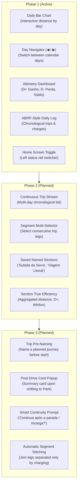
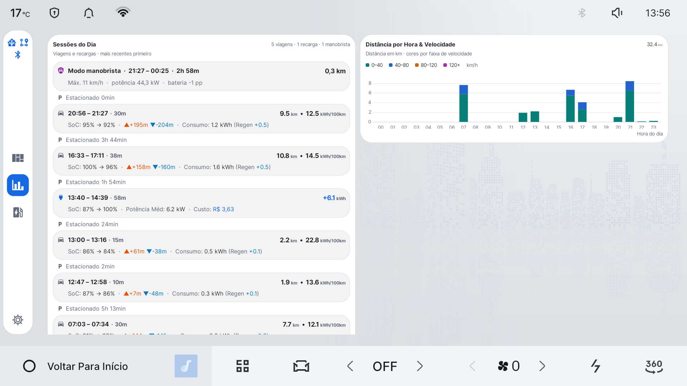

# Trip Statistics & Efficiency Telematics

Drive Assist provides comprehensive trip analysis, energy accounting, and altimetry metrics for the Geely EX2 / Geometry E (IHU629G).

---

## 🗺️ Architectural Roadmap

---

## ⚡ Phase 1: Daily Statistics & ABRP Session Log (Current)

Phase 1 provides an interactive daily overview directly on the IHU display:

*Figure 1: Drive Assist's chronological session log and hourly distance chart, running live on the Geely EX2 IHU629G head unit (1920x1080 display). **Sessões do Dia** lists the day's drives, charging sessions, and Valet-mode intervals in reverse-chronological order — each row showing time range, duration, distance, efficiency (Wh/km), SoC change, ascent/descent, and energy consumed/regenerated, with parked gaps interleaved between them. **Distância por Hora & Velocidade** breaks the day's total distance down by hour, colored by speed bucket (0–40, 40–80, 80–120, 120+ km/h).*

### 1. Interactive Daily Bar Chart & Navigation
- **Bar Chart (MPAndroidChart)**: Displays daily distance (`last_odo_km - first_odo_km`) over the past 14 days.
- **Interactive Day Selection**: Tap any column on the bar chart, or tap the **`[ ◀ Ontem ]`** and **`[ Amanhã ▶ ]`** navigation buttons to inspect that day's statistics.
- **Visual Highlighting**: The currently selected day is prominently accented while other bars remain subtle.

### 2. Cumulative Altimetry (D+ & D-)
Elevation changes heavily influence EV range. Rather than simple point-to-point elevation difference, Drive Assist tracks cumulative vertical work:
- **D+ (Ganho Positivo Acumulado)**: Sum of all climbing elevation gains throughout the day ($\sum \Delta h > 0$, noise-filtered $> 3\text{m}$).
- **D- (Perda Negativa Acumulada)**: Sum of all descending elevation losses ($\sum |\Delta h| < 0$).
- **Saldo Líquido**: $\text{D+} - \text{D-}$ (net elevation gain/loss).
- Correlating D+ with **Regeneração (kWh)** and **Eficiência (Wh/km)** shows exactly how terrain shaped battery consumption.

### 3. ABRP-Style Chronological Session Log
Inspired by A Better Routeplanner's daily diary, the selected day's activities are displayed in an interleaved, chronological feed:
- 🚗 **Viagens (Drives)**:
  - Departure & Arrival time, duration (e.g. `08:15 – 09:30 • 1h 15m`).
  - Distance (km) and SoC change (`100% ➔ 64%`).
  - Altimetry breakdown (`▲ +680 m  ▼ -210 m`).
  - True Efficiency (`Wh/km`) and energy regenerated (`kWh`).
  - Odometer at the start and the end (`Odometer 12,345 → 12,398 km`), on the
    title line. The route screen shows it too, under Distance.
- 🔌 **Recargas (Charges)**:
  - Start & completion time, duration.
  - Energy added in `+kWh`.
  - SoC change (`28% ➔ 80%`).
  - Charging speed (`kW avg`) with AC mains vs DC Fast Charge detection (peak `charge_v >= 300V`).
  - Odometer at plug-in (`Odometer 12,398 km`), on the title line. The
    charge's page shows it too, just before Cost.
- 🅿️ **Parked gaps** between two sessions: tap one to set what the stop cost
  (`parking_cost`, a car park or paid street parking). A priced gap shows its
  place and price; a gap of 15 min or more shows a quiet `+ R$`.
- **Filters**: All, Trips, Charges, and Parking (parked stops of 15 min or
  more or priced, plus Valet stays). The counts are on the filter buttons.
- 🔗 **Join trips** (Day view, issue #210): the link icon on the Sessions card
  opens pick mode. Each session is one line with a rail on the left; tap the
  first and the last trip. The ends get arrows pointing in, and a blue line
  covers every row between them (trips, parked gaps, charges). **Join** is off
  while a Valet stay or a running session is in the range. A joined card has
  a "N trips" chip; its numbers are the sums of its trips (km, energy, climb,
  tolls), battery and odometer run from the first start to the last end. The
  parked gaps and charges inside it are listed in the card (a gap can still be
  priced there) and leave the main list. The Parking filter still lists those
  gaps.

### 4. Home Screen View Switcher
- A dedicated statistics icon in the left status rail of `ComfortActivity` allows swapping the home screen between the standard comfort card grid and the new statistics screen with a single tap.

### 5. Trip Route Screen
On the statistics page, tap a finished trip (in **P**) to open its route:

- **Route on a map.** GPS points drawn over an OpenStreetMap map, north up,
  with start and end marks. No API key and no use limit. The map pictures
  (tiles) are kept on the car, so a place seen once shows again with no
  internet. A tile that is not on the car and cannot be fetched is left
  out: the line then shows on the plain background, as before.
- **Speed colours.** Each part has the colour of its speed. The buckets and
  colours are the same as on the statistics page: 0–40, 40–80, 80–120 and
  120+ km/h. The scale is fixed, so two trips compare at a glance.
- **All routes in one picture.** A tap on the map beside the sessions on
  the statistics page draws every route of the period on screen (day, week,
  month or year) together, with the same speed
  colours, and lists the trips. Under the picture, the height profile of
  every trip shown, one after the other. **Previous** / **Next** step
  through the days that have a route; **Show all** shows the whole week, month or year again (all trips when it was opened from one day).
  Touch a route or a trip in the list to select it: it is drawn thick over
  the others and the profile shows that trip only. **Open this trip** shows
  its own route screen.
- **Height profile.** Under the route, the GPS height along the trip, in the
  same speed colours. Touch it to mark that place on the route. Dashed lines
  with a label on top mark each toll passage and, on a joined trip, the
  parking (`P 16m`) or the charge between its trips. In split mode only, a P
  line also marks each shift to P inside the trip (`park_session`, `P 44s`).
- **Split and undo** (issue #210). A trip splits only at a shift to P inside
  it (a `park_session` row that starts and ends inside the trip; the P that
  ends a trip runs past it). No such stop, no **Split** button. Split mode
  picks the first shift to P at once; **‹ / ›** step through them ("P stop 2
  of 3 · 17:30 · P 44s"), or drag on the height chart (the cut goes to the
  nearest one; with no heights the chart is shown flat). The two new trips
  show on the right before **Split here**. The first part ends when the car went into P, the next
  starts when it left P. A part's odometer and battery come from the 30 s
  samples at the cut, looked for inside the trip only (no reading: the trip
  shows whole); km, energy and climb from inside the part, capped at what is
  left, and the last part gets the rest, so the parts add up to the trip.
  CAN's energy split follows each part's share of the energy used; a toll
  goes to one part only. The IMU scores are the whole trip's, so a part shows
  none. **Undo split** puts the
  trip back whole; **Undo join** shows a joined trip's trips again.
- **How it is stored.** The `trip` rows never change. `trip_edit` (`car.db`
  v39) holds one row per join (a time window: every trip that starts and ends
  in it shows as one) or per cut (a trip id and the cut's two ends, the same
  moment or the two ends of a stop). Undo deletes the row; **Undo split** also
  deletes a join that started or ended inside that trip (a part joined with
  the next trip), so it cannot come back unseen on a later split. The CSV and GPX
  exports and All routes use the trips as recorded.
- **Tolls and parking.** The trip's tolls (tap one to set its price), **+ Add
  a missed toll** at the place marked on the height profile, the parking paid
  on arrival (or **+ Add parking**), and the trip's tolls + parking.
- **Trip numbers.** Distance, moving and stopped time, average and top speed,
  energy, Wh/km, battery start and end, climb and descent, lowest and
  highest point, outside temperature.

Routes are recorded with **Config → System → Trip routes** (on by default):
one point every 5 s, only after 25 m of movement, with drive mode, regen
level and energy so far. The points stay in the car (`car.db` table
`trip_point`) and go into the backup. Trips driven before route recording
existed show no route. GPS fixes do not need MQTT. Data details:
[HUB-DATA.md](HUB-DATA.md).

---

## 🛣️ Phase 2: Continuous Trip Segments & Named Sections (Intent)

Phase 2 will move beyond strict 24-hour calendar days to support natural multi-leg journeys:

1. **Continuous Trip Feed**:
   - A scrolling timeline of discrete driving trips (`trip` table), crossing midnight boundaries seamlessly.
2. **Multi-Leg Selection**:
   - Checkboxes or gesture selection to pick multiple sequential trips (e.g., Trip #42, Trip #43, and Trip #44).
3. **Saved Named Sections**:
   - Name and persist custom sections (e.g., *"Viagem a Curitiba"*, *"Subida da Serra"*, or *"Corrida de Aplicativo - Sexta"*).
4. **The True Trip Efficiency Aggregate**:
   - Calculates combined metrics across all selected legs:
     - Distance $= \text{Odo}_{\text{end}} - \text{Odo}_{\text{start}}$.
     - Cumulative D+ and D-.
     - Total Regen captured (kWh).
     - Time-weighted HVAC active percentage.
     - True integrated efficiency (Wh/km).

---

## 🤖 Phase 3: Interactive Trip Assistant (Intent)

Phase 3 will introduce smart trip lifecycle management:

1. **Trip Pre-Naming & Departure Intent**:
   - Driver can name an upcoming trip before departure (or via Home Assistant MQTT command).
2. **Post-Drive Arrival Card**:
   - When shifting to Park (`gear = 4`), a summary card automatically displays key stats for that specific leg.
3. **Smart Continuity Prompt**:
   - The card will prompt: *"Deseja continuar esta viagem após a parada ou recarga?"*
   - If confirmed, subsequent driving legs and charging stops remain stitched into the same active session until the driver marks it finished.
